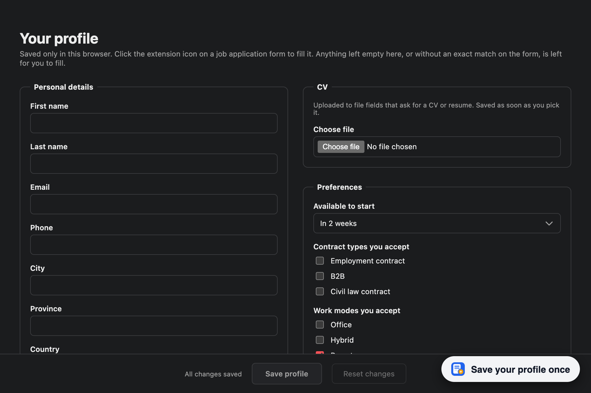

<p align="center">
  
</p>

<h1 align="center">Job Autofill</h1>

<p align="center">
  Fill job application forms with your saved profile in one click.<br>
  A Chromium extension (Manifest V3) for Google Chrome and ungoogled Chromium.
</p>

## What it fills

- **Text fields and textareas:** first name, last name, email, phone, city, province (województwo), country, and salary. A single box for the whole name (Full name, Name, Imię i nazwisko) gets your first and last name, and only when both are saved.
- **Choice questions** (native selects, Selectize dropdowns, ARIA combobox dropdowns such as react-select or Radix Select, radio groups): English level, availability, contract types, work mode, and salary buckets.
- **Language levels on a form's own scale.** When a level question offers no CEFR codes, only a known scale such as Brak, Podstawowy, Komunikatywny, Dobry, Biegły, Ojczysty, your level is placed by position: native at the top, C1 or C2 one step below it, B2 the step below that, and so on. This applies only when every option is a known proficiency word, there are at least four, and one end is clearly the lowest. The page console names the option picked so you can check it.
- **Province and country dropdowns** labelled Województwo or Kraj (or Province, Country): the option with your saved name is picked. A "woj." or "województwo" prefix on the option is ignored, so "Mazowieckie" matches "woj. mazowieckie". A country saved in one language is also found under its name in another, so "Poland" picks "Polska" and "Deutschland" picks "Niemcy". If two options name the same country, the dropdown is left for you.
- **Traffit city dropdown:** the "Lokalizacja (Miasto)" search box. The extension searches for your saved city and picks the result whose name matches. English city names such as Warsaw, and names typed without ł such as Wroclaw, are looked up by their Polish spelling, and anything after a comma or bracket ("Warszawa, Polska") is ignored. The country dropdown is left as the form set it. When the city is not filled, the page console says why.
- **Start date boxes** (Start date, Available from, Data rozpoczęcia): today plus your saved availability, so "In 2 weeks" fills the date two weeks from now. A native date input always gets it; a text box only when its placeholder shows the format, such as DD.MM.YYYY or RRRR-MM-DD.
- **Required consent and terms boxes** (opt-in, under Preferences): a checkbox the form marks as required is ticked when it agrees to data processing, the privacy policy, or the terms ("Wyrażam zgodę na przetwarzanie moich danych osobowych…", "Akceptuję regulamin", "I accept the terms and conditions"). Optional boxes, captcha widgets, and anything that also mentions future recruitment, talent pools, marketing, newsletters or partners are never ticked.
- **CV upload:** file inputs labelled CV, resume, or życiorys get your saved CV. Inputs for a cover letter or portfolio are left alone, and so is any input whose `accept` attribute excludes your file type.

A choice is filled only when exactly one option on the page matches your answer. Anything ambiguous, such as "hybrid" on a form with four hybrid options or a salary between two buckets, is left for you. Inputs that already have a value are never overwritten.

- **City search boxes** that follow the ARIA combobox pattern: the extension types your city (then its Polish spelling) and picks the result named like it. A result that only contains the name, such as "Warsaw Chopin Airport", is not taken, and a search that finds nothing is cleared.

- **Lever "Current location"**: a search box that keeps only a value picked from its results. The extension types your city (or the answer you saved for that question), waits for the results, and picks the one named like it. When several places share the name, such as Warsaw in Poland and in Indiana, your saved country decides. The field picker's **Save and fill** does the same on this box. Lever reads an attached CV and writes what it finds into every field nobody has typed in, so the extension waits for that to finish before it fills the location (the panel says so while it waits). A location the CV filled is left as it is.

## How it works



- **Adapters** identify fields. The first vendor adapter whose `detect()` matches runs, then the generic adapter handles everything it did not claim. To add an ATS, write `src/content/adapters/<vendor>.ts` and add it to `VENDOR_ADAPTERS`.
- **ARIA comboboxes** cannot be given a value directly, so the driver does what a person does: it opens the list, reads its `role="option"` rows, and clicks the single one that matches. A dropdown that already shows a value is never opened.
- **Drivers** put values into controls. Values are set through the native setter, followed by `input` and `change` events, so React and Vue forms register them.
- **Selectize** keeps its options in a page JavaScript object that the isolated content script cannot see. The service worker runs `src/background/mainWorld.ts` in the page's MAIN world to read options and call `setValue`. Only element tags and option ids cross that boundary, plus your city for the location search, since the page sends those to its own server anyway.
- **After a fill**, a small panel in the bottom-right corner lists the questions still empty under "Left for you", with required ones first and marked. Hidden fields, honeypots and optional checkboxes are not listed. Close it with × or Esc. When nothing is left, a short note says so and disappears after a few seconds. The panel shows only the questions, never your answers.
- **The CV** of each profile is stored in `chrome.storage.local` as base64 under its own key (`cv:<profile id>`), so reading a profile never loads it. `unlimitedStorage` lifts the 10 MB quota. The content script loads it only when the page has a CV field, then sets it on the input through `DataTransfer`.
- The extension uses `activeTab`, so it can touch a page only after you click the icon on it.

## Candidate profiles

Apply with more than one CV, for example "Backend – EN" and "Frontend – PL":

- **Shared by all profiles:** first name, last name, email, phone, the consent setting and your saved answers.
- **Each profile's own:** CV, location (city, province, country), preferences (availability, contract types, work mode), links, languages and salary.

On the profile page, the bar at the top picks the profile you are editing and offers **New**, **Duplicate** (values and CV included), **Rename**, **Delete** and **Use for filling**. The last profile cannot be deleted. If you switch to another profile with unsaved changes, the page asks to save them first and stays put if you cancel.

One profile is used for filling at a time. Switch it from the extension icon's right-click menu (**Fill with profile**), or press **Alt+Shift+P** (**Option+Shift+P** on a Mac) to move to the next one. The icon flashes the first two letters of the new profile, and its tooltip names the profile in use.

Your data from before profiles existed becomes a profile called "Default", CV included.

## Saved answers

For questions the extension does not know (e.g. "Czy znasz Dockera i OpenShift?"), save your own answer:

1. On the job form, right-click the extension icon and choose **Pick a field and save an answer**, or press **Alt+Shift+I** (**Option+Shift+I** on a Mac) (change it at `chrome://extensions/shortcuts`).
2. Click the field: a text box, a dropdown, one option of a radio group (or its label), or a custom dropdown such as react-select. A panel shows the field's question (editable) and an answer box. For a dropdown or radio group, the answer box lists the field's own options to choose from.
3. **Save and fill** stores the answer and fills the field. Esc cancels.

From then on, one click fills any field whose question matches, ignoring case, Polish letters and punctuation. For a dropdown or radio group, the option whose text is the saved answer is chosen, and only when exactly one option has that text ("Yes" on "Are you legally authorised to work in India?"). Otherwise the question is left for you, and the page console says why. A saved answer never replaces a value from your profile: on a field your profile fills, such as your name, email or work mode, the profile wins. A saved answer fills it only while the profile leaves it empty, and never changes a field that already has an answer. Saved answers are listed, editable and removable on the profile page.

## Languages of job forms

Every word the matcher looks for lives in `src/content/locales/`, one JSON file per language (`en.json`, `pl.json`). Write words naturally, with diacritics ("imię", "miejscowość"); they are normalised when loaded. Words from all files are combined, so a form in either language matches.

To support another language, add `src/content/locales/<code>.json` with any of the same sections, import it in `src/content/locales/index.ts`, and add it to `LOCALES`. `npm test` checks that every file only uses known field, option, language and level ids.

Things that do not depend on a language stay in code: HTML `autocomplete` tokens, input types, and CEFR codes such as "C1".

## Development

```sh
npm install
npm test          # matcher unit tests (Vitest + jsdom)
npm run typecheck
npm run build     # outputs dist/
```

Load it: open `chrome://extensions`, turn on Developer mode, click "Load unpacked", and choose `dist/`. After a rebuild, click the reload button on the extension card.

### End-to-end tests

```sh
npx playwright install chromium   # once
npm run build && npm run e2e
```

`npm run e2e` loads the built extension into headless Chromium and fills the local forms in `e2e/fixtures/` with a fake profile, checking what is filled and what is left alone. A test cannot click the toolbar icon, so the script first copies `dist/` to `dist-e2e/` with host access to `127.0.0.1` and `localhost`, and the test injects `content.js` the same way the click does. The shipped `dist/` is unchanged. Set `CHROMIUM_PATH` to use a Chromium you already have; branded Google Chrome ignores `--load-extension`. These tests are not part of `npm test`.

## License

[MIT](LICENSE)
